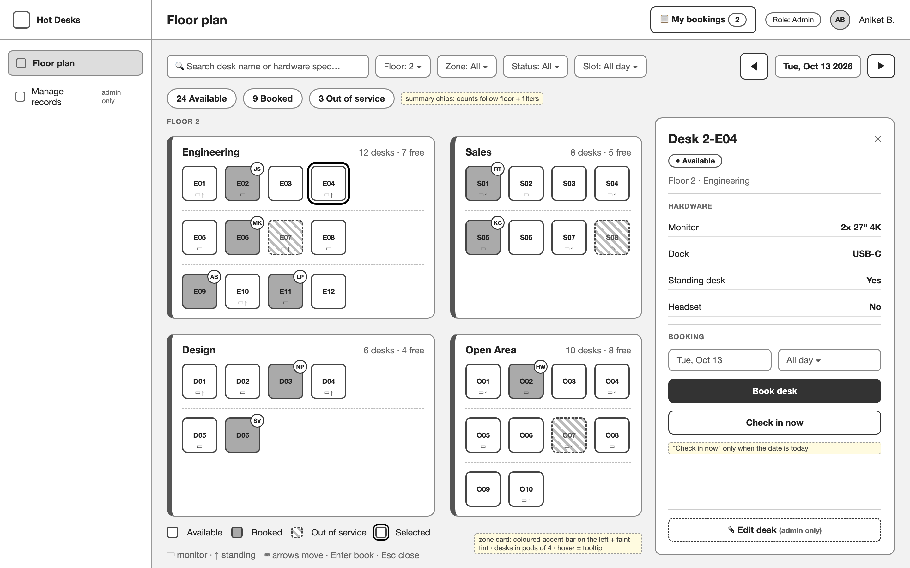
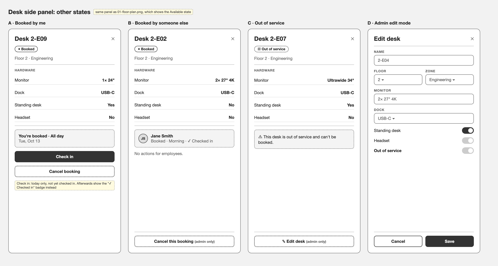
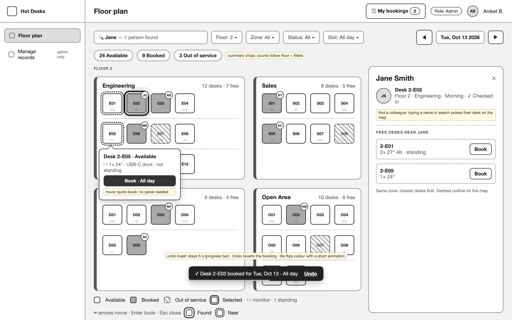
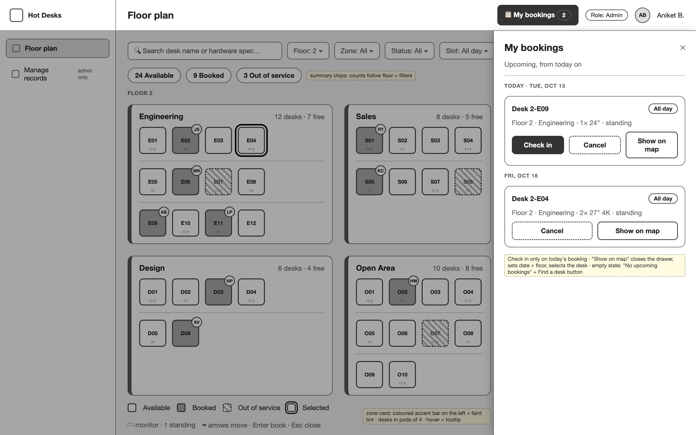
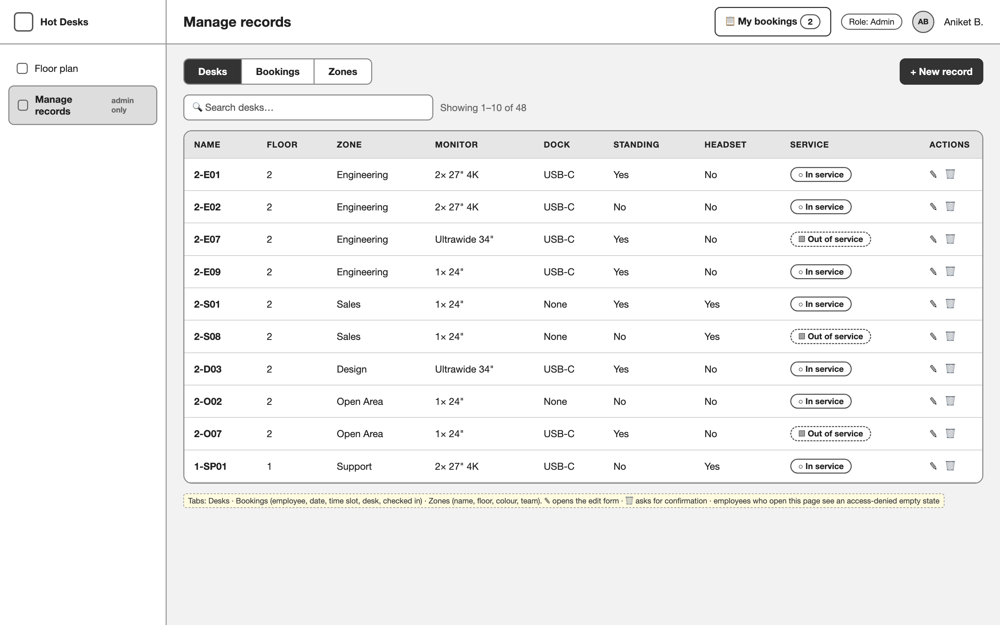
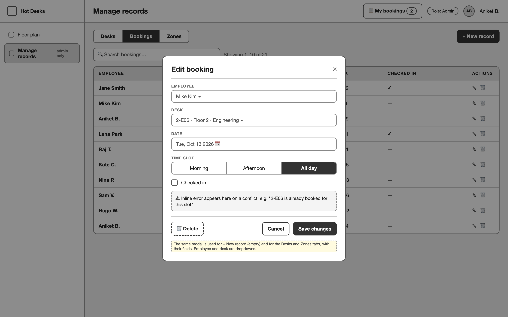

# Hot-Desking App

## The request

I want an app to manage hybrid work hot-desking across our office. There should be tables for desks (with floor, zone, and hardware/equipment specs), desk bookings (employee, date, time slot, desk), and office zones or neighborhoods so desks can be grouped by team area. As an employee, I want to view an interactive floor plan showing all desks color-coded by status (available, booked, out of service), search or filter desks by zone, floor, or status, and click a desk to open a side panel with its hardware specs so I can check in or book it myself. As an administrator, I should have permission to edit any records, in addition to that standard employee access. Please make the floor plan feel modern and polished — use color accents, clear visual hierarchy, and well-organized spacing rather than a plain grid of boxes. Also create some demo data so it is easy to test and demonstrate.

## How to use the wireframes

The wireframes below add detail to the request above. They are greyscale and define **layout only**: placement, grouping, hierarchy and which controls exist. Do not copy their colours, fonts or styling. Choose a modern, polished visual style yourself, as the request asks. Yellow sticky notes in the images are annotations, not UI.

| Image | Shows |
|---|---|
| `01-floor-plan.png` | Main screen with an available desk selected |
| `02-panel-states.png` | The other desk side panel states |
| `03-manage-records.png` | Admin records screen (Desks tab) |
| `04-edit-form.png` | Admin edit modal (Bookings tab) |
| `05-find-colleague.png` | Find a colleague, hover quick-book, undo toast |
| `06-my-bookings.png` | My bookings drawer |

## 0. Scope

**Build these:**
1. App shell: sidebar and top bar
2. Screen A: **Floor plan**. Every user. Search and filters, a colour-coded desk map, a desk side panel, hover quick-book, find a colleague, an undo toast and keyboard navigation.
3. **My bookings** drawer. Every user.
4. Screen B: **Manage records**. Admins only. Editable tables for Desks, Bookings and Zones.
5. Demo data (section 7).

**Roles:**
| Role | Floor plan | Book / check in | Edit any record |
|---|---|---|---|
| Employee | ✓ | ✓ (own bookings) | ✗ |
| Admin | ✓ | ✓ | ✓ (desks, bookings, zones) |

The admin role includes all employee access. Ordinary employees must be able to reach the app and the Floor plan, not just admins.

**Out of scope:** analytics, integrations, notifications, recurring bookings, QR codes, visitors, meeting rooms.

---

## 1. Visual Direction

The floor plan should feel modern and polished. Use colour accents, clear visual hierarchy and well-organised spacing, not a plain grid of boxes.

- Desk status is colour-coded: available, booked and out of service each get a distinct colour. Out-of-service desks also get a striped pattern, so status doesn't rely on colour alone.
- Each zone has its own accent colour, used on its card header and as a faint tint.
- Hierarchy runs page title, then a summary stats row, then zone cards, then desk tiles.
- Use soft shadows, rounded corners and consistent spacing. Leave clear gaps between zone cards and between pods of desks.
- Use short transitions for tile colour changes, the panel and drawer sliding in, and the toast.

---

## 2. App Shell

See the top bar and sidebar in `01-floor-plan.png`.

- The sidebar holds **Floor plan** and **Manage records**. Show Manage records only to admins.
- The top bar shows the screen title, a **My bookings** button with a count badge (section 4), a role badge and the user avatar.
- On narrow screens the sidebar collapses into a hamburger menu.

---

## 3. Screen A: Floor Plan (all users)

### Components
- **DateNavigator**: prev and next arrows plus a date label. Statuses are computed for the selected date and slot.
- **SearchBox**: free-text search on desk name, hardware specs **and employee names**. Desks that don't match are dimmed rather than removed, so the layout stays stable. Employee-name matches trigger find a colleague (section 3.1).
- **Filters**: Floor (1, 2), Zone (All plus each zone), Status (All, Available, Booked, Out of service), and Slot (All day, Morning, Afternoon). Zone cards that end up with no matching desks are hidden.
- **SummaryStats**: three chips counting desks by status, using the current floor and filters.
- **ZoneCard**: a card with an accent bar in the zone colour. The header shows the zone name, desk count and free count. Desks are grouped in pods of 4 with a gap between pods.
- **DeskTile**:
  - Its colour comes from status. Out-of-service desks get a striped pattern.
  - It shows the short desk code, plus small icon hints for its hardware (▭ monitor, ↑ standing).
  - A booked desk shows the booker's initials as a small avatar in the corner.
  - Hover lifts the tile slightly and shows the quick-book popover (section 3.1). A selected desk gets a clear selection ring.
- **Legend**: the 3 statuses, the selected state, the hardware icon hints and a keyboard hint.
- **DeskSidePanel** (slides in from the right). It shows the desk name, a status pill, floor and zone, and a hardware specs list. The actions depend on the desk's state. The *Available* state is in `01-floor-plan.png`, and the rest are in `02-panel-states.png`.
  1. *Nothing selected*: an empty state reading "Select a desk to see its details".
  2. *Available*: slot select, **Book desk** and **Check in now**. Check in now creates a booking for today and checks the user in straight away. It only shows when the selected date is today.
  3. *Booked by me*: "You're booked · {slot}" with **Check in** (today only and not yet checked in) and **Cancel booking**. Once checked in, it shows a "✓ Checked in" badge.
  4. *Booked by someone else*: the booker's avatar, name and slot. No actions for employees.
  5. *Out of service*: an info note reading "This desk is out of service". No booking actions.
  - **Admins only:** an **Edit desk** button switches the panel into a form. The form edits name, floor, zone, the out-of-service toggle and the hardware fields, with Save and Cancel. Admins can also cancel anyone's booking from state 4.

### 3.1 Interactions

- **Hover quick-book.** Hovering over an available desk (or focusing it with the keyboard) shows a popover under the tile. The popover holds the desk name, status, a one-line hardware summary and a **Book · {slot}** button that books it with the slot from the current filter. Booked and out-of-service desks show the same popover with no button. The popover closes when the pointer leaves the tile or the popover.
- **Find a colleague.** When the search text matches an employee who has a booking on the selected date:
  - Their desk gets a pulsing ring, and the map scrolls it into view.
  - The side panel switches to a **person view**: avatar, name, their desk, floor, zone and slot, and check-in status.
  - Under "Free desks near {name}" it lists up to 3 available desks in the same zone, closest first, each with a **Book** button. Those desks get a dashed outline on the map.
  - If nobody matches, or the person has no booking that day, show "{name} isn't in the office on {date}".
- **Undo toast.** Every book and cancel shows a dark toast at the bottom centre, for example "✓ Desk 2-E03 booked for Tue, Oct 13 · All day · **Undo**". It stays for a few seconds with a shrinking progress bar. **Undo** reverts the action and restores any booking that was replaced. The desk tile animates its colour change.
- **Keyboard navigation.** The map is a single tab stop.
  - Arrow keys move focus between desks in reading order within a zone, and then on to the next zone. The focused desk gets a visible focus ring and shows its popover.
  - **Enter** opens the side panel for the focused desk. Pressing Enter again on the panel's primary button books the desk.
  - **Esc** closes the popover, then the panel, then the drawer, in that order.

### 3.2 Behaviour rules
- **Status** for a date and slot is `out of service` if the desk is flagged out of service. It is `booked` if any booking on that date overlaps the slot; All day overlaps both halves. Otherwise it is `available`.
- An employee can hold only one booking per date and slot. If they book a second desk, the first one is replaced. The toast says "(replaced 2-E09)", and Undo restores it.

---

## 4. My Bookings Drawer (all users)

- The top-bar **My bookings** button opens a drawer from the right over a dimmed backdrop. The button's badge shows the number of upcoming bookings.
- Bookings from today onward are grouped by date, with today first.
- Each card shows the desk, a slot pill, and the floor, zone and a hardware summary. Its actions are:
  - **Check in**: today's booking only, and only before check-in. After check-in, show a "✓ Checked in" badge instead.
  - **Cancel**: shows the undo toast.
  - **Show on map**: closes the drawer, sets the date and floor, and selects the desk.
- Empty state: "No upcoming bookings" with a **Find a desk** button that closes the drawer.
- The drawer closes on ✕, a backdrop click or Esc.

---

## 5. Screen B: Manage Records (admins only)

- **Tabs and their columns:**
  - **Desks**: name, floor, zone, monitor, dock, standing, headset, and service (In service or Out of service). Date-based availability is not shown here.
  - **Bookings**: employee, date, time slot, desk, checked in.
  - **Zones**: name, floor, colour, team.
- Each tab has a search box and a result count.
- ✎ opens a modal form with the record's fields. **+ New record** opens the same form empty. 🗑 deletes after a confirm dialog.
- Changes are reflected straight away on the Floor plan.
- Employees who navigate here directly see a "You don't have access to this page" empty state.

- **Edit modal:** centred over a dimmed backdrop.
  - Reference fields (employee, desk, zone) are dropdowns, and the time slot is a segmented control.
  - Conflict errors appear inline above the buttons, for example "2-E06 is already booked for this slot".
  - The footer has **Delete** on the left and **Cancel** and **Save changes** on the right.

---

## 6. Data

| Entity | Fields |
|---|---|
| Zone | name, floor (1 or 2), accent colour, team |
| Desk | name (for example "2-E04"), floor, zone, out of service (yes/no), hardware: monitor, dock, standing desk (yes/no), headset (yes/no) |
| Booking | desk, employee, date, time slot (All day, Morning or Afternoon), checked in (yes/no) |
| Employee | name, initials (derived from the name), role (Employee or Admin) |

Desk availability is not stored. It is worked out from bookings for the selected date and slot (section 3.2).

## 7. Demo Data

Enough to test and demonstrate every screen above:
- Several zones across two floors (for example Engineering, Sales, Design, Open Area, Support, Quiet Zone).
- A few dozen desks spread across those zones, with varied hardware and a handful marked out of service.
- A small set of employees: one admin and several employees, including "Jane Smith" so find a colleague is easy to demo.
- A couple of dozen bookings across today and the next few days, mixing All day, Morning and Afternoon, some already checked in, and two upcoming bookings for the current user.

---

## 8. Acceptance Checklist

- [ ] The floor plan renders zone cards with accent colours, and desks coloured by available, booked or out of service.
- [ ] Search, plus the floor, zone, status and slot filters, all work and update the summary stats.
- [ ] Clicking a desk opens the side panel with hardware specs and the right actions for its state.
- [ ] Book, check in, check in now and cancel all work, and a second booking for the same slot replaces the first.
- [ ] Hovering over or focusing a desk shows the quick-book popover, and its Book button works.
- [ ] Searching a colleague's name pulses their desk and lists nearby free desks that can be booked.
- [ ] Every book or cancel shows the undo toast, and Undo fully reverts the action.
- [ ] Arrow keys, Enter and Esc work on the map as described.
- [ ] The My bookings drawer lists upcoming bookings with Check in, Cancel and Show on map.
- [ ] Admins can edit desks from the side panel and create, edit and delete desks, bookings and zones in Manage records.
- [ ] Employees can't see the admin edit controls or the Manage records page.
- [ ] Demo data for zones, desks, employees and bookings is present, so the app can be tested and demonstrated straight away.
- [ ] The layout is usable on a phone-width screen (sidebar collapses, panel and drawer become full-width sheets).
